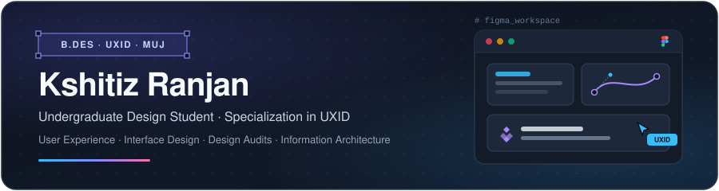
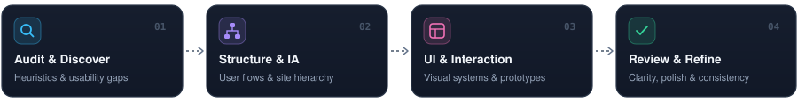
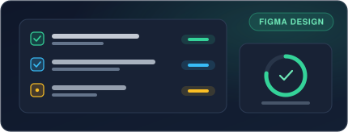
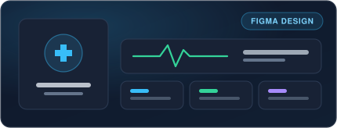
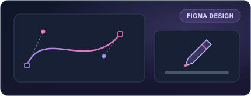
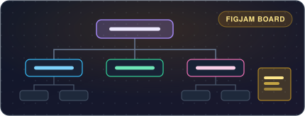

  

 

<h2>
  
  &nbsp;About Me
</h2>

> Undergraduate design student pursuing a **B.Des** with a specialization in **UXID** at **MUJ**, focused on crafting intuitive interfaces, structured information architecture, and usability-driven digital experiences.

<table width="100%">
  <tr>
    <td width="33%" valign="top">
      <strong>Education</strong> 
      Undergraduate · B.Des
    </td>
    <td width="33%" valign="top">
      <strong>Specialization</strong> 
      UXID
    </td>
    <td width="34%" valign="top">
      <strong>Institution</strong> 
      MUJ
    </td>
  </tr>
</table>

 

<h2>
  
  &nbsp;Design Workflow
</h2>

  

 

<h2>
  
  &nbsp;Selected Figma Work
</h2>

<table width="100%">
  <tr>
    <td width="50%" valign="top">
      
        
      <strong>Design Audit</strong> · <code>Figma Design</code>
      
Comprehensive design audit examining interface consistency, usability patterns, and actionable visual improvements.

      
    </td>
    <td width="50%" valign="top">
      
        
      <strong>Health Care 6D</strong> · <code>Figma Design</code>
      
Healthcare-focused UX/UI design exploration centered on clarity, structured workflows, and accessible user journeys.

      
    </td>
  </tr>
  <tr>
    <td width="50%" valign="top">
      
        
      <strong>Stylus</strong> · <code>Figma Design</code>
      
Product and interface design study crafted in Figma with an emphasis on interaction detail and clean visual hierarchy.

      
    </td>
    <td width="50%" valign="top">
      
        
      <strong>Content Delivery Site — Information Architecture</strong> · <code>FigJam Board</code>
      
Structured site mapping and information architecture blueprint organizing navigation paths, content hierarchy, and user flows.

      
    </td>
  </tr>
</table>

 

<h2>
  
  &nbsp;Toolkit &amp; Focus Areas
</h2>

  &nbsp;
  &nbsp;
  &nbsp;
  
   
  &nbsp;
  &nbsp;
  &nbsp;
  

 

<h2>
  
  &nbsp;Connect
</h2>

  
    
  

